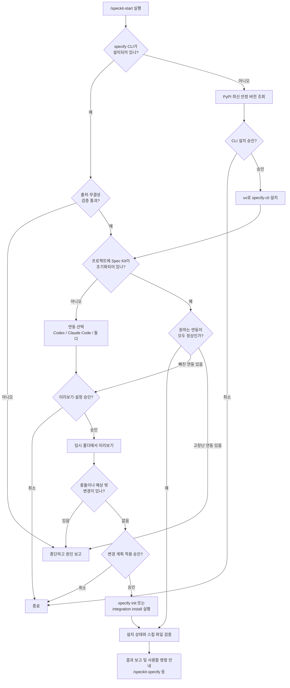

# SpecKit-Start

프로젝트마다 GitHub Spec Kit CLI와 에이전트 연동을 확인하는 작업을 줄여 주는 공용 스킬입니다. Codex 또는 Claude Code에서 한 번 호출하면 현재 프로젝트의 준비 상태를 확인하고, 승인받은 설치와 설정을 공식 `specify` CLI로 진행합니다. 스펙 작성부터 구현까지의 SDD 작업은 GitHub Spec Kit의 스킬에 맡깁니다.

## 지원 환경

- Windows의 로컬 Codex 및 Claude Code를 기준으로 개발했습니다. 스킬의 변경 계획을 확인하고 적용하려면 Python 3.11 이상이 필요합니다. macOS와 Linux에서는 운영체제에 맞는 Spec Kit 스크립트를 선택합니다.
- 사용할 Codex 또는 Claude Code를 먼저 설치하세요. Specify CLI가 없을 때는 [uv](https://docs.astral.sh/uv/getting-started/installation/)를 사용합니다.
- 새 프로젝트 설정에는 `init --integration`과 `integration status --json`을 지원하는 CLI가 필요합니다. 기존 프로젝트에 에이전트를 추가하려면 `integration install`과 해당 조합의 멀티 연동도 지원해야 합니다.

## 설치 · 업데이트 · 제거

`skills/speckit-start` 폴더의 `SKILL.md`와 `guard.py` 두 파일을 사용하는 에이전트의 스킬 폴더에 넣으면 설치가 끝납니다. 두 파일은 항상 같은 폴더에 같은 버전으로 두세요.

| 도구 | 스킬 폴더 | 프로젝트 대화창에서 실행 |
| --- | --- | --- |
| Claude Code | `~/.claude/skills/speckit-start` | `/speckit-start` |
| Codex | `~/.agents/skills/speckit-start` | `$speckit-start` |

> 스킬 폴더와 그 상위 경로에 심볼릭 링크나 정션이 없는지 먼저 확인하세요. 이 스킬은 링크로 연결하지 않고 파일을 복사해서 설치합니다.

### 설치

**Windows (PowerShell)** — Claude Code

```powershell
$d = "$HOME\.claude\skills\speckit-start"
$u = "https://raw.githubusercontent.com/JEONJEA/SpecKit-Starter/main/skills/speckit-start"
New-Item -ItemType Directory -Force $d | Out-Null
foreach ($f in "SKILL.md", "guard.py") { Invoke-WebRequest "$u/$f" -OutFile "$d\$f" -UseBasicParsing }
```

**Windows (PowerShell)** — Codex

```powershell
$d = "$HOME\.agents\skills\speckit-start"
$u = "https://raw.githubusercontent.com/JEONJEA/SpecKit-Starter/main/skills/speckit-start"
New-Item -ItemType Directory -Force $d | Out-Null
foreach ($f in "SKILL.md", "guard.py") { Invoke-WebRequest "$u/$f" -OutFile "$d\$f" -UseBasicParsing }
```

**macOS · Linux** — Codex는 `d`를 `~/.agents/skills/speckit-start`로 바꾸세요.

```bash
d=~/.claude/skills/speckit-start
u=https://raw.githubusercontent.com/JEONJEA/SpecKit-Starter/main/skills/speckit-start
mkdir -p "$d" && for f in SKILL.md guard.py; do curl -fsSL "$u/$f" -o "$d/$f"; done
```

설치한 뒤 사용할 프로젝트에서 Claude Code나 Codex를 새로 열고 `/speckit-start` 또는 `$speckit-start`를 입력합니다.

### 업데이트

설치 명령을 그대로 다시 실행하면 두 파일이 최신 버전으로 함께 바뀝니다. 실행 전에 [커밋 기록](https://github.com/JEONJEA/SpecKit-Starter/commits/main/skills/speckit-start)에서 바뀐 내용을 확인하고, 업데이트한 뒤에는 새 세션을 여세요.

저장소를 클론해 두었다면 최신 내용을 받은 뒤 두 파일을 복사해도 됩니다. Codex는 경로의 `.claude`를 `.agents`로 바꾸세요.

```powershell
git pull
Copy-Item skills\speckit-start\SKILL.md, skills\speckit-start\guard.py "$HOME\.claude\skills\speckit-start\" -Force
```

### 설치 확인

```powershell
Get-ChildItem "$HOME\.claude\skills\speckit-start", "$HOME\.agents\skills\speckit-start" -ErrorAction SilentlyContinue
```

사용하는 도구의 폴더에 `SKILL.md`와 `guard.py`가 모두 보이면 됩니다. 새 세션에서 `/speckit-start`(Codex는 `$speckit-start`)가 목록에 나타나는지도 확인하세요.

### 제거

스킬 폴더만 지웁니다. 이미 설정한 프로젝트의 `.specify`, `.agents`, `.claude` 파일은 그대로 남습니다.

```powershell
Remove-Item "$HOME\.claude\skills\speckit-start" -Recurse   # Claude Code
Remove-Item "$HOME\.agents\skills\speckit-start" -Recurse   # Codex
```

## 스킬 실행 과정



각 단계의 자세한 내용은 다음과 같습니다.

1. PATH와 패키지 관리자 기록을 대조해 실행 파일의 출처를 확인한 뒤 `specify version`을 실행합니다. uv 설치는 도구 경로, 영수증, 배포 메타데이터, 런처 해시를 함께 확인합니다. Python 런처에 Authenticode 서명이 없다는 이유만으로 차단하지 않습니다. 설치가 필요하면 공식 PyPI에서 조회한 최신 안정 버전과 설치 위치를 제시하고 승인받습니다.
2. 작업 범위 안에서 프로젝트 루트를 확인합니다. 외부 어댑터 설치 흔적을 먼저 점검하고, 안전하게 호출할 수 있을 때 `specify integration status --json`으로 상태를 확인합니다.
3. 새 프로젝트에서는 **Codex + Claude Code**, **Codex만**, **Claude Code만** 중 원하는 연동을 선택합니다. 두 가지를 선택하면 Codex로 한 번 초기화하고 Claude Code를 추가합니다.
4. 대상 경로와 명령, 예상 변경을 승인받습니다. 승인 후 임시 디렉터리에서 생성 경로를 확인하고 실제 프로젝트의 충돌과 링크를 검사합니다. 변경 범위가 늘어나면 다시 승인받습니다. Spec Kit 이벤트 등록을 끄고 기본 SDD 스킬을 구성합니다.
5. 상태와 실제 스킬 파일을 다시 확인합니다. 준비가 끝나면 Codex에서는 `$speckit-specify`, `$speckit-clarify`, `$speckit-plan`, `$speckit-tasks`를, Claude Code에서는 같은 이름의 `/speckit-…` 명령을 사용할 수 있습니다.

연동 선택과 각 승인은 채팅에 직접 입력하지 않고 선택지 버튼으로 고릅니다. Claude Code에서는 `AskUserQuestion`을, Codex에서는 `request_user_input`이나 `request_user_input_async`를 사용합니다. Codex는 답을 받을 때까지 턴을 끝내지 않고 기다립니다. 질문 도구가 없는 환경에서는 번호 목록으로 보여 주고 번호나 이름으로 답할 수 있습니다.

이미 초기화된 프로젝트에서는 별도 선택이 없으면 현재 실행 중인 에이전트를 기준으로 확인합니다. 예를 들어 Codex가 연동된 프로젝트에서 Claude Code로 실행하면, 승인을 받은 뒤 공식 `specify integration install claude` 명령으로 Claude Code 연동을 추가합니다. 프로젝트의 기본 에이전트는 Codex로 유지되며, 두 에이전트는 같은 프로젝트의 Spec Kit 설정과 SDD 문서를 사용합니다. 준비된 프로젝트에서는 상태 확인만으로 끝납니다.

기존 프로젝트에 연동을 추가할 때는 현재 CLI 버전으로 만든 미리보기와 공용 파일 목록 및 스크립트 종류가 일치해야 합니다. 공용 파일이 누락됐거나 오래된 관리 파일이 남아 있으면 쓰기 전에 중단합니다. 연동과 초기화 옵션 메타데이터 외에 CLI가 교체하는 공용 파일 매니페스트도 승인 계획에 포함합니다.

### 변경 계획만 보기

에이전트에 “`speckit-start`로 Codex와 Claude Code 설정의 변경 계획만 보여줘”라고 요청하세요. 대상 경로, 예정된 명령, 확인된 변경과 미리보기 후 확인할 항목을 출력합니다. 적용을 요청한 경우에는 먼저 임시 미리보기 승인을 받고, 실제 생성·갱신 경로에 대한 승인을 받은 뒤 프로젝트에 적용합니다. CLI 설치 계획은 uv 도구 환경, 런처, 캐시 위치를 표시합니다. uv가 해결할 개별 의존성 파일은 설치 시점에 결정됩니다.

## 문제 해결

| 증상 | 확인할 사항 |
| --- | --- |
| 설치했지만 `specify`를 찾지 못함 | `uv tool dir --bin`이 알려 주는 폴더에서 실행 파일을 확인하세요. uv로 설치한 경우 `uv tool update-shell`로 PATH를 설정한 뒤 터미널과 에이전트를 다시 열 수 있습니다. |
| `uv tool list` 잠금 오류 또는 서명 없는 `specify.exe` | uv 실행 파일과 도구 설치 경로를 구분하세요. `uv tool dir`, `uv tool dir --bin`, `uv cache dir`의 경로, `uv-receipt.toml`, `specify-cli` 배포 메타데이터와 `RECORD`를 교차 확인합니다. 영수증에 출처가 없으면 uv 캐시의 정확한 wheel URL이 `files.pythonhosted.org`인지 확인합니다. 1.4.2는 공식 wheel에서 계산한 파일 해시로 오프라인 검증합니다. 그 밖의 버전은 공식 PyPI에서 해당 버전의 wheel을 메모리로 받아 SHA-256과 설치 파일 내용도 대조합니다. 이 확인에는 네트워크 연결이 필요합니다. 디렉터리를 `Get-FileHash`에 넘기지 말고, 출처나 런처 무결성을 확인할 수 없으면 중단하세요. 서명 없는 Python 런처라는 이유만으로 차단하지는 않습니다. |
| `Plan changed or was not approved` | 승인한 계획과 적용 시점의 상태가 다르다는 뜻입니다. 오류 메시지가 명령·대상 파일이 바뀐 것인지, PATH나 `TEMP` 같은 자식 환경이 바뀐 것인지 알려 줍니다. 계획과 적용은 같은 환경에서 실행해야 합니다. Git처럼 추가로 필요한 경로가 있으면 계획을 만들기 전에 PATH에 넣고, 이미 승인했다면 새 계획을 만들어 다시 승인받으세요. |
| `uv`가 없음 | [uv 공식 설치 안내](https://docs.astral.sh/uv/getting-started/installation/)에 따라 설치한 뒤 새 터미널에서 다시 실행하세요. |
| 기존 CLI 또는 프로젝트 형식이 오래됨 | `specify version`과 [공식 업그레이드 가이드](https://github.github.com/spec-kit/upgrade.html)를 확인하세요. 프로젝트에 로컬 수정이 있다면 먼저 백업하거나 커밋해 두세요. |
| 파일 충돌이나 쓰기 권한 오류 | 보고된 경로의 기존 파일과 권한을 확인하세요. 초기화가 도중에 실패했다면 다시 실행하기 전에 `.specify` 상태와 Git 변경 사항을 확인하세요. |
| 스킬이 대화창에 표시되지 않음 | 설치 경로와 프로젝트 루트를 확인하고 새 세션에서 다시 여세요. 지원되는 Claude Code에서는 `/reload-skills`도 사용할 수 있습니다. |

## 검증

보안 테스트는 Python 표준 라이브러리와 PowerShell 7을 사용합니다. 승인과 충돌 처리, 경로 이탈 및 정션, 중복 실행, 외부 입력, 민감정보 환경변수, 실패 후 중단을 검증합니다.

```powershell
python -B -m unittest discover -s tests -p 'test_*.py' -v
```

기능 테스트는 공백과 한글이 포함된 임시 홈과 프로젝트에서 공식 Specify CLI를 사용합니다. Codex와 Claude Code의 단독 설정, 순서를 바꾼 두 에이전트 연동, 기존 설정과 문서 보존, 재실행을 확인합니다. 에이전트 실행 파일 감지에는 테스트용 실행 파일을 사용합니다.

```powershell
# 기존 CLI로 프로젝트 초기화와 에이전트 연동 검증
./tests/smoke.ps1 -SpecifyCli (Get-Command specify -CommandType Application | Select-Object -First 1).Source

# 신규 CLI 설치도 검증. 공식 PyPI 접근 필요
./tests/smoke.ps1 -Uv (Get-Command uv -CommandType Application | Select-Object -First 1).Source
```

GitHub Actions는 push와 pull request에서 보안 검사와 Windows 기능 검사를 각각 실행합니다. 실제 클라이언트의 승인 UI와 스킬 인식은 [보안 테스트 시나리오](tests/security.md)를 따라 확인합니다.

## 공식 문서

- [GitHub Spec Kit](https://github.com/github/spec-kit)
- [Spec Kit 설치 가이드](https://github.github.com/spec-kit/installation.html)
- [Spec Kit 연동 CLI](https://github.github.com/spec-kit/integrations/cli.html)
- [Codex 스킬](https://developers.openai.com/codex/skills)
- [Claude Code 스킬](https://code.claude.com/docs/en/skills)
